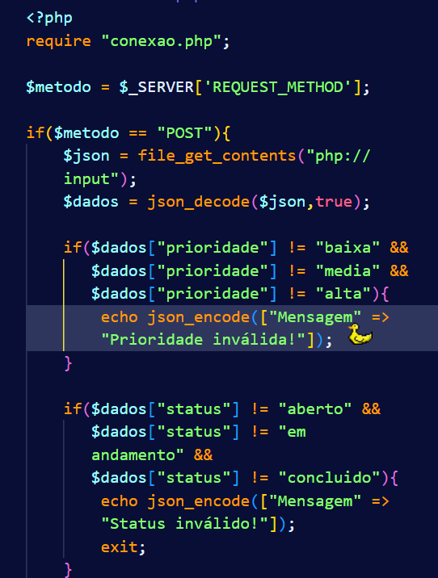
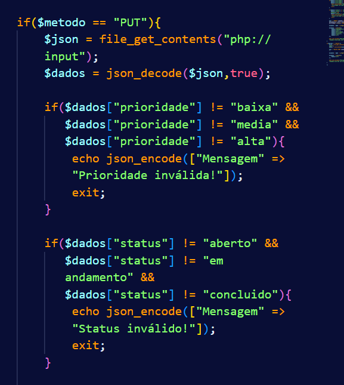
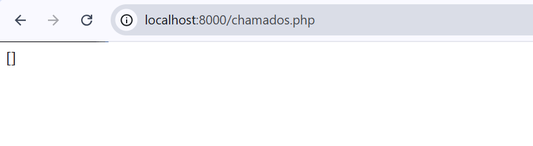

# Criação de API REST (GET,POST,PUT,DELETE) com SQL 

## Passo a passo

### 1- Passo:  
>Crie um banco de dados chamado manutencao e uma tabela chamada chamados. 

*MOBA*

*TABELA NO VSC*
> A tabela deverá possuir os campos id, equipamento, setor, descricao, prioridade e status. O campo id deverá ser a chave primária e possuir incremento automático.

----

### 2- Passo:
>A API deverá utilizar PDO, receber e devolver os dados no formato JSON e implementar as quatro operações básicas de um CRUD

Para isso usamos os arquivos "conexao.php" e "chamados.php".

---

### 3- Passo:
>A prioridade deverá aceitar os valores baixa, media ou alta, enquanto o status deverá aceitar aberto, em andamento ou concluido

Para isso, modifiquei algumas coisas no arquivo "chamados.php" :

----

### 4- Passo:
>Antes de executar uma operação, o sistema deverá verificar se os dados obrigatórios foram informados. Quando uma operação for concluída, a API deverá retornar uma mensagem em JSON informando seu resultado.

---

*GET*

----

*POST*

---

*PUT*

----

*DELETE*

